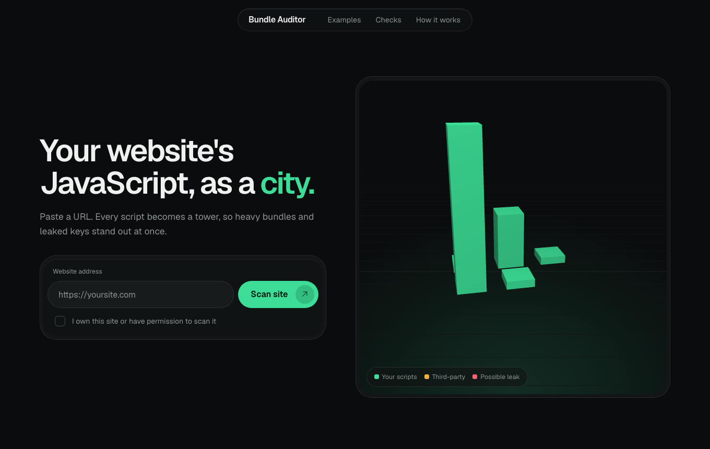

# Bundle Auditor

See your website's JavaScript as a 3D city. Paste a URL and every script on the page becomes a tower. Taller means heavier. The tool also flags possible leaked API keys, third-party scripts and source-map references.



## Real results

Snapshots of public homepages, scanned 2026-11-09. They describe what each homepage loaded at that moment. They are not a rating of the sites.

| Site | Scripts | Raw | Gzip |
|---|---|---|---|
| GitHub | 5 | 2,761 KB | 851 KB |
| React docs | 11 | 1,304 KB | 425 KB |
| Vercel | 25 (cap) | 1,172 KB | 346 KB |
| Stripe | 25 (cap) | 178 KB | 71 KB |
| Wikipedia | 2 | 27 KB | 9 KB |
| Hacker News | 1 | 5 KB | 1 KB |

The tool reads at most 25 scripts per page, so capped rows are a lower bound.

## What it checks

- **Leaked keys:** AWS, Google, Stripe live, GitHub and Slack tokens and private key blocks. Findings are masked.
- **Bundle weight:** raw and gzip size per script.
- **Third-party scripts:** outside hosts that run code on the page.
- **Source maps:** scripts that reference a source map. It does not check whether the map file is publicly reachable.

## Run locally

Needs Node 20 or newer. No dependencies to install.

```bash
npm start
```

Open http://localhost:3000. Run the tests with `npm test`.

## Deploy (Render, free tier)

1. On render.com choose New, then Blueprint, and pick this repo. `render.yaml` sets it up, including `TRUST_PROXY` so the per-visitor limit sees real client addresses.
2. Render gives you a public `https://...onrender.com` address.

GitHub Pages cannot host this app because it needs a running server for the scan API.

## Limits and safety

- Free scans are limited to 3 per visitor per day and 500 per day overall. Counters live in memory and reset on restart.
- Private, local and non-http addresses are blocked. DNS is resolved twice (once to check, once to fetch), so a hostile DNS server could slip through. Pin the resolved IP before facing hostile users at scale.
- Only scan sites you own or have permission to scan.

## License

MIT
